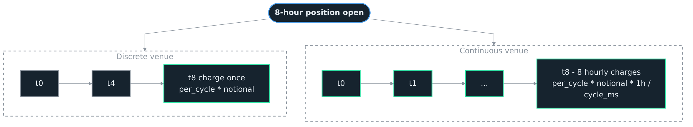

<h1>OCEΛNO <small><code>exchange-router</code></small></h1>


<div style="padding-top: 0px;">
  <a href="https://www.python.org/downloads/"></a>
  <a href="https://fastapi.tiangolo.com/"></a>
  <a href="https://opensource.org/licenses/MIT"></a>
</div>

<sub>
  <a href="../README.md">Introduction</a> &nbsp;•&nbsp;
  <a href="Python_API.md">Python API</a> &nbsp;•&nbsp;
  <a href="HTTP_Reference.md">HTTP Reference</a> &nbsp;•&nbsp;
  <b>Exchange Notes</b> &nbsp;•&nbsp;
  <a href="Architecture.md">Architecture</a> &nbsp;•&nbsp;
  <a href="Decisions.md">Decisions</a> &nbsp;•&nbsp;
  <a href="Migration.md">Migration</a> &nbsp;•&nbsp;
  <a href="Adapter_Guide.md">Adapter Guide</a> &nbsp;•&nbsp;
  <a href="Contributor_Guide.md">Contributor Guide</a> &nbsp;•&nbsp;
  <a href="Auditor_Guide.md">Auditor Guide</a>
</sub>

<br>
<br>
<br>
<br>

## Exchange Notes

Quirks per exchange that callers can observe: symbol formats, fields the upstream does not expose, retention windows that bound historical queries, and unit semantics that survive normalisation. The schema is uniform across exchanges; the data behind it is not always. The router never invents data, so missing fields come back as `null`, `0` or an empty string depending on the model, and queries past retention come back as an empty list.

<br>
<br>

## Shared Conventions

<br>

### Symbol normalization

All adapters normalize to bare trading pairs (`BTCUSDT`, `ETHUSDT`) with no exchange-specific suffixes. The market type in the URL path conveys that context, so a symbol like `BTCUSDT` means different things depending on whether the path is `/binance/spot/`, `/binance/linear/`, or `/binance/inverse/`.

Normalization rewrites a symbol's format, not its asset. Kraken's `XBT` stays `XBT` (see [Legacy asset codes stay literal](#legacy-asset-codes-stay-literal)), so one coin can carry a different symbol on each exchange, and code that reads several exchanges keeps its own map between them.

`GET /{exchange}/{market_type}/markets` returns a dict `{exchange, market_type, count, markets}` where `markets` is an array of **lite** entries carrying `symbol`, `status`, `base`, `quote`, the `qty` unit and contract size, and `funding`. To get the full specs for one symbol (including `native_symbol`, the raw symbol as it appears on the exchange's own API), call `GET /{exchange}/{market_type}/markets/{symbol}`:

```json
{
  "symbol": "BTCUSD",
  "native_symbol": "BTCUSD_PERP",
  ...
}
```

Examples of the mapping: `BTCUSD` (model) <-> `BTCUSD_PERP` (upstream), `XBTUSD` <-> `PF_XBTUSD`, `BTCUSD` <-> `BTC-USD-SWAP`. Use `native_symbol` when you need to cross-reference a normalized symbol back to the exchange's documentation or raw API. Per-venue rules for what gets stripped or rewritten live in the venue sections below.

Every data route serves a market in any state its exchange lists, halted, pre-launch or cancel-only included, and answers it with its real `quote`. `/markets/{symbol}` answers it too, with the state in `status`; the market list holds the markets that trade, and `?status=` lists the others. A symbol the exchange does not list at all is refused with one 400 titled `Unknown Symbol` that names the market list; the router reads the exchange's list again first, at most once a minute, so a market listed since the last read is found. A stream for an unlisted symbol sends the same body and closes with 1003.

<br>

### Empty book sides

A side with no orders is answered with its price and its size `null` on every exchange, never refused and never dropped from a stream. Binance and OKX send such a side as `0.0` themselves, and the router reads that `0.0` as the empty side it is.

<br>

### Quiet markets

Binance, Bybit, OKX and Kraken send a zero-volume bar for every interval up to now on a market that has stopped trading. KuCoin and Hyperliquid send no bar after a market's last trade, and KuCoin, spot and futures, leaves gaps between trades too, so a window of `limit` intervals can hold fewer bars or none. KuCoin futures already pages back until it has `limit` bars. When an answer comes back short on KuCoin spot or Hyperliquid, the router asks again over the widest window they serve and keeps the newest `limit` bars, so `limit` counts bars on every exchange and a quiet market answers with its newest bars, however old. That costs a second request whenever an answer comes back short, including where the exchange simply holds fewer bars than `limit`. A bar that was never sent is not filled in. A paged read stops only where the exchange holds nothing older, and the short-result warning says so.

For a market with no trade in 24 hours the exchanges disagree: OKX and Bybit repeat the last price as the open, high and low; KuCoin sends `0` for the high and low; Kraken and Binance send `0` throughout. The router answers them all one way: a ticker whose 24-hour volume is zero has its open, high, low and change `null`, and a ticker with no last trade at all has its `price` `null`.

<br>

### Perpetuals only on contract markets

For `linear` and `inverse` market types, both `/markets` and `/markets/{symbol}` return perpetual contracts only. Quarterly and dated futures are excluded by every adapter. Spot markets are unaffected and return every active pair.

<br>

### Tick and step

`SymbolInfo.price` and `SymbolInfo.qty` are the grid an order has to sit on, as each exchange states it: `price.tick` in `quote`, and `qty.step` in `qty.unit`. `decimals` counts the decimal places the step implies and says less: a step of 10 or more has `decimals` `0`. Check an order against the step, not the decimals.

| Exchange | `price.tick` | `qty.step` |
| :--- | :--- | :--- |
| Binance | `PRICE_FILTER.tickSize` | `LOT_SIZE.stepSize`, in contracts on inverse |
| Bybit | `priceFilter.tickSize` | `lotSizeFilter.qtyStep` on linear, `lotSizeFilter.qtyStep` in contracts on inverse, `lotSizeFilter.basePrecision` on spot |
| OKX | `tickSz` | `lotSz` times `ctVal` on linear, `lotSz` in contracts on inverse, `lotSz` on spot |
| Kraken | `tick_size` on spot, `tickSize` on futures | ten to the minus `lot_decimals` on spot, ten to the minus `contractValueTradePrecision` on futures |
| KuCoin | `priceIncrement` on spot, `tickSize` on futures | `baseIncrement` on spot, `lotSize` times `multiplier` on linear, `lotSize` in contracts on inverse |
| Hyperliquid | none: `price.kind` is `significant_figures`, five figures with at most 6 minus `szDecimals` decimals on perpetuals and 8 minus `szDecimals` on spot | ten to the minus `szDecimals` |

A step built from two exchange numbers is their decimal product, converted to a float once, so it is the float nearest the number the exchange means: `0.1` times `0.1` gives `0.01`, where a float product gives `0.010000000000000002`. Both fields are still floats, so test a price against the grid by rounding the quotient, not by comparing floats.

<br>

### Margin tiers

`/margin_tiers` serves an exchange's table of how leverage falls and margin rises as a position grows, on the perpetuals of Bybit, OKX and Hyperliquid.

| Exchange | Source | `up_to_unit` | Left `null` |
| :--- | :--- | :--- | :--- |
| Binance | none, the route answers `501` | | |
| Bybit | `risk-limit` for the symbol | `quote` on linear, `base` on inverse | `maintenance_deduction` on the first tier, which Bybit leaves blank |
| OKX | `position-tiers` for the swap's family, the cross-margin table | `base` on linear (`maxSz` contracts times `ctVal`), `contract` on inverse | `maintenance_deduction`, which OKX does not send |
| Kraken | none, the route answers `501` | | |
| KuCoin | none, the route answers `501` | | |
| Hyperliquid | `marginTables` in the `metaAndAssetCtxs` response the instrument list is read from | `quote` | both rates and `maintenance_deduction`, which Hyperliquid does not serve |

A Bybit or OKX table is read the first time it is asked for and kept 24 hours; Hyperliquid's arrive with its instrument list and refresh with it. Hyperliquid numbers its single-tier tables below 50 and lists only the tiered ones, 50 and above: an asset on a single-tier table, which most are, answers one open tier at the leverage Hyperliquid serves for the asset, and an asset whose tiered table is missing from the response fails rather than answering one tier. Binance's keyless table sits behind its website rather than in the API it documents, Kraken publishes several tables per instrument and which one applies depends on the account, and KuCoin applies a separate rule under cross margin, so the three stay off ([0022](Decisions.md)).

<br>

### Data fidelity rule

The router never invents data. When an upstream omits a field, the router surfaces the gap honestly rather than guessing:

* Missing string fields come back as `""`.
* A record that arrives without its own value, a trade or liquidation with no price or size, a funding row with no rate, a mark price with no value, is refused: a 502 on REST, a skipped frame on a stream. Before 3.3.0 some adapters wrote `0.0` in its place.
* An instrument whose exchange leaves out a number the router would otherwise have to make up, an inverse contract's size or a tick or quantity step, stays out of the market list.
* Missing list responses come back as `[]`, never a synthesized "best guess".
* Queries past upstream retention return an empty list.
* An exchange outage reported inside a 200 body, as Bybit, OKX, KuCoin and Kraken do, is retried and then answered 503, like an HTTP outage. A request that pages back fails as a whole when any page fails; it never returns the pages it got as if they were all.

`SymbolInfo` follows this rule with a split by type. The string fields, `base` and `quote`, come back as `""` when the adapter cannot derive them, which is why the Kraken futures note below calls out symbols whose suffix is not in the quote-currency list. The order limits, `qty.min`, `qty.max` and `notional.min`, come back `null`, never `0`, when the exchange does not publish the limit; each exchange's section below documents which of them tend to be missing. On `SymbolInfo` a `0` is therefore always a value the upstream sent, not a stand-in for absence. `qty.step` comes back `null` when the exchange states no step, and a price kept to significant figures has no `price.tick` at all. The tick is never worked out from a count of decimals; where an exchange states its quantity step only as a count of decimals, as Kraken and Hyperliquid do, `qty.step` is ten to the minus that count.

The same rule applies to derived values such as the `notional` on `open_interest`: on linear markets it is priced at a same-period candle's close, and where the exchange has no candle of that period, or none at that time, `notional` comes back `null` with `native` still populated. A candle read that fails fails the open interest request with it. The router does not substitute a stale close, a ticker price, or a back-of-envelope estimate.

<br>

### Open interest units differ by exchange and market

`OpenInterest.open_interest` is the upstream-native count of open positions, carried alongside the `notional` and `notional_basis` slots described below. Several unit conventions exist across the matrix:

| Exchange / market | `unit` | `native` is in | example BTC perp |
| :--- | :--- | :--- | :--- |
| Binance LINEAR  | `base`     | base coin                                                                  | `94,201.6` BTC |
| Binance INVERSE | `contract` | contracts (`contract_size` = $100 for BTCUSD)                              | `11,674,843` contracts ~ $1.17B nominal |
| Bybit LINEAR    | `base`     | base coin                                                                  | `51,528` BTC |
| Bybit INVERSE   | `contract` | contracts (`contract_size` = $1)                                           | `403,155,610` contracts = $403M nominal |
| Kraken LINEAR (PF\_\*)   | `base`     | base coin                                                         | `1,898.7` BTC |
| Kraken INVERSE (PI\_\*)  | `contract` | contracts (`contract_size` = $1)                                  | none listed, see [No inverse perpetuals are listed](#no-inverse-perpetuals-are-listed) |
| KuCoin LINEAR   | `base`     | base coin (adapter pre-multiplies upstream contracts * multiplier)         | `30,361` BTC (= 30,361,348 contracts * 0.001) |
| KuCoin INVERSE  | `contract` | contracts (`contract_size` = $1)                                           | `120,701,769` contracts = $121M nominal |
| OKX LINEAR      | `base`     | base coin (adapter reads upstream's `oiCcy` column directly)               | `34,223.4` BTC |
| OKX INVERSE     | `contract` | contracts (`contract_size` = `ctVal`, $100 for BTC-USD-SWAP)               | `5,847,300` contracts = $584.7M nominal |

Each open-interest row carries a `notional` in its `open_interest` value object: inverse (contract-unit) rows multiply contracts by `contract_size`, and linear (base-unit) rows join to a same-period candle close, which `notional_basis` names with the candle's stamp. When no matching candle is found the router leaves `notional` null rather than guessing it. Hyperliquid's live reading is priced at the mark it arrives with (see [Open interest is a current snapshot, not a history](#open-interest-is-a-current-snapshot-not-a-history)).

<br>

### Pagination is always backward-walking

Every endpoint that takes `end` follows the [backward-walking pagination contract](HTTP_Reference.md#pagination-semantics); per-venue upstream mechanics differ but the user-visible behavior is identical. Where the upstream walks forward only, the adapter computes a synthetic forward start, fetches a window, and truncates. Backward-anchored requests on forward-walking upstreams are slightly slower than on natively-backward ones.

<br>

### Rate-limit and ban protection

User-facing behaviour lives here; the backoff and fail-fast flow is in [Architecture](Architecture.md#rate-limiting); implementation patterns (header-driven proactive, reactive on rejection, minimum-spacing, per-adapter fail-fast thresholds) live in [Adapter Guide](Adapter_Guide.md#rate-limit-headers-and-proactive-backoff).

Every adapter handles rate-limit and ban behaviour transparently. You can call any route at full speed; a steady stream runs as fast as upstream allows, a burst slows down on its own, and a hard ban window surfaces as an immediate fail-fast error until it clears. No per-call sleep loops or client retry logic needed. Per-exchange retry and ban specifics live in each exchange's section below.

<br>

### Trade and timestamp conventions

Trade `side` is always normalized to `"buy"` or `"sell"` (taker side). A liquidation's `side` is the side of the liquidation order, so a liquidated long reads `"sell"` on every exchange. Timestamps are always Unix milliseconds. Orderbook levels are `[price, size]` tuples; `size` follows the same unit as `qty` for the same market, see each exchange's section for the per-market specifics.

<br>

### Snapshot clocks

Each adapter stamps a snapshot with the most upstream-faithful time it has, and `time_source` says whose clock that is: `venue` for the exchange's own time, `router` for the router's clock at the read, where the exchange sends no time.

- **Ticker.** Bybit, OKX, Kraken futures and KuCoin spot stamp it with the time on their response (within ~1s of wall clock). Hyperliquid, Kraken spot and KuCoin futures send no time with it, so it carries the router's clock. Binance stamps it with the `closeTime` field from `/ticker/24hr`, which empirically lags wall clock by 5-10 seconds because Binance's 24-hour rolling statistics pipeline aggregates with non-zero delay; the price data itself is real-time.
- **Book ticker and order book.** The router's clock on Binance spot and Kraken spot, whose answers carry no time; the venue's elsewhere.
- **Mark price.** The router's clock on Hyperliquid; the venue's elsewhere.
- **Open interest.** Every history row carries the venue's time; Hyperliquid's live reading carries the router's.
- **Symbol info.** Always the router's clock: `timestamp` is when the router read the exchange's record.

Any snapshot whose exchange leaves the time out of one answer carries the router's clock for that answer. Consumers gauging freshness across exchanges should skip a `router` stamp, which says nothing of the exchange, and expect Binance's tickers to look 5-10s "older" than the others.

<br>

### Trade `id` formats

`Trade.id` and `AggTrade.agg_id` are exchange-specific opaque strings. Treat them as identity keys, not numbers. Per-exchange formats:

| Exchange | Format | Example |
| :--- | :--- | :--- |
| Binance | numeric integer string | `"6354281581"` |
| OKX | numeric integer string | `"1013326135"` |
| Bybit | UUID with hyphens | `"f960a6cf-2bcb-5f4e-9881-49a724a253dd"` |
| KuCoin | large integer string | `"1933627152931"` |
| Kraken spot | numeric integer string (upstream `trade_id`; timestamp-based fallback on rows that omit it) | `"61044952"` |
| Kraken futures | UUID via `uid` | `"ab32ca5f-e761-4a6d-a094-1d3f4aa8693c"` |

Consumers parsing `id` as integer will fail on Bybit and Kraken futures. Always store as string.

<br>

### Funding cycle and `valid_until`

For the `kind` discriminator semantics see [Interpretation Fields](HTTP_Reference.md#interpretation-fields) in the HTTP Reference. `MarkPrice.funding.valid_until` is when the current `per_cycle` rate stops being the current rate, and its `kind` says which of two things that time is:

| Exchange | typical `cycle_ms` | `valid_until.kind` | What `valid_until.ts` is |
| :--- | :--- | :--- | :--- |
| Binance, Bybit, OKX, KuCoin | 28,800,000 (8h) | `settlement` | The next settlement, the one the current `per_cycle` rate is charged at, less than one cycle ahead. Most pairs are 8h, but the value varies per symbol (some pairs settle every 4h or every hour); each adapter caches the per-symbol interval from the upstream's instruments endpoint. Before 3.3.0 OKX's was one cycle later. |
| Hyperliquid, primary dex | 3,600,000 (1h) | `settlement` | The next top-of-hour settlement. |
| Hyperliquid, builder dexes | 3,600,000 (1h) | `estimate` | One cycle after the reading, since these markets settle hourly but not on the clock hour. |
| Kraken futures | 3,600,000 (1h) | `estimate` | One cycle after the reading. The rate accrues across each hour rather than settling at a boundary, so no charge happens there. |

A consumer that does `next_settlement = now + cycle_ms` will be wrong on Kraken. Use `valid_until.ts` as the deadline where its kind is `settlement`, and as a horizon where it is `estimate`. To compute a uniform per-hour rate across all exchanges, divide `per_cycle` by `cycle_ms / 3_600_000`.

An exchange can change a symbol's cycle, and each funding history row carries the cycle it settled under, read from the gaps to its neighbours, so a history that crosses a change from 4h to 1h shows 4h before it and 1h after. A single longer gap is a pause and keeps its neighbours' cycle. When the router cannot read a symbol's current cycle from the exchange, the cycle stays unknown and is read again on the next request; it is never assumed to be 8h.

<br>

### 1000-prefix symbols (PEPE, SHIB, FLOKI)

Some venues quote sub-cent tokens as 1000-units to keep prices in a tradable range:
- **Binance, Bybit**: list as `1000PEPEUSDT`, `1000SHIBUSDT`. The reported price is per 1000 tokens.
- **OKX, KuCoin**: list as `PEPEUSDT`, `SHIBUSDT`. The reported price is per single token (with many leading zeros).

The router faithfully exposes whatever the upstream names the symbol. A consumer querying PEPE on multiple venues must map symbols accordingly: `1000PEPEUSDT` on Binance and Bybit, `PEPEUSDT` on OKX and KuCoin. Underlying USD volume math is internally consistent on each exchange.

<br>

### Long/short ratio account breakdown

Kraken and OKX expose only the `ratio` scalar; on both, `long_account` and `short_account` come back `null` and `account_scope` is `"opaque"`. The adapters that expose the account split populate both fields (decimals summing to roughly 1.0) alongside `ratio`. Consumers needing the breakdown across all venues should branch on the presence of `long_account`, not on exchange name.

<br>
<br>

## Binance

<br>

### Symbol format

Binance COIN-M (inverse) perpetuals carry a `_PERP` suffix in the exchange API (`BTCUSD_PERP`, `ETHUSD_PERP`). The router normalizes them to bare pairs (`BTCUSD`, `ETHUSD`). Use the `native_symbol` field on `/markets/{symbol}` responses if you need to cross-reference back to Binance's docs.

<br>

### Liquidations REST is disabled

Forced liquidation history is not available via public REST. The endpoints (`/fapi/v1/allForceOrders` on USDM, `/dapi/v1/allForceOrders` on COINM) require authentication, so `liquidations.rest` is `False` for both linear and inverse. The WebSocket stream (`forceOrder@arr`) is public, so `liquidations.ws` is `True`.

<br>

### COIN-M `qty` and `volume` are in contracts

For COIN-M (inverse) perpetuals, `qty.native` and `volume.native` are reported in contracts, not the base asset. For `BTCUSD_PERP`, 1 contract represents 100 USD of notional. The native count stays in contracts; the same record carries `contract_size` and `notional = native * contract_size` per the standard inverse layout, and the per-instrument multiplier is on `/markets/{symbol}` as `qty.contract_size`. Divide `notional` by `price` if you need a base-asset volume. USD-M (linear) and SPOT report `qty` and `volume` in the base asset directly.

<br>

### A contract being settled has no ticker

Binance keeps a delisted perpetual in its instrument list while it settles, under the state `SETTLING`, which the router reads as `halted`, and answers its 24-hour ticker with an empty object. The router answers that ticker with every price and `volume_24h` `null`, stamped with its own clock, since nothing trades there; its book, mark price and history are served as Binance sends them. An empty ticker for a market that trades is still answered `502`.

<br>
<br>

## Bybit

Bybit uses bare-pair symbols natively (`BTCUSDT`, `ETHUSDT`) on spot and on most contracts, where `native_symbol` matches `symbol`. Its USDC perpetuals are named `BTCPERP`, `ETHPERP` upstream; the router names them by base and quote like every other market (`BTCUSDC`), keeps `BTCPERP` in `native_symbol`, and still accepts `BTCPERP` in a request. The contract markets hold Bybit's pre-launch and delivering instruments as well as its trading ones; a closed contract is not listed.

<br>

### IP bans

Bybit returns HTTP 403 (not 429) on persistent rate-limit violations. These are IP bans on the order of 10 minutes. The router fails the triggering request immediately and rejects subsequent requests with HTTP 503 (plus a `Retry-After` header) until the ban window has passed. Soft per-endpoint limits are handled internally with brief backoff and retry.

<br>

### Inverse `volume24h` and `turnover24h` semantics

For inverse perpetuals (`BTCUSD`, `ETHUSD`), Bybit reports `volume24h` in **contract count** (each contract = 1 USD on Bybit inverse) and `turnover24h` in the **base coin** (BTC). The adapter lands `Ticker.volume_24h.native` from `volume24h` directly, sets `volume_24h.unit` to `"contract"` on inverse, sets `volume_24h.contract_size` to `1.0`, and resolves `volume_24h.notional` via `native * contract_size` (so the USD figure is exact, not a derivation from `turnover24h`). Spot and linear follow the conventional layout (`volume24h` = base, `volume_24h.unit = "base"`, the notional at the ticker's own price). The `notional_basis.method` field tells you which conversion ran.

<br>

### Long/short ratio derivation

The Bybit account-ratio endpoint returns `buyRatio` and `sellRatio` directly. The router maps `long_account = buyRatio` and `short_account = sellRatio`, and computes `ratio = buyRatio / sellRatio`. This is the inverse of the OKX convention (where the upstream sends a single `ratio` and no account split). A row with a zero `sellRatio` is skipped rather than emitted with a fabricated ratio, since the division is undefined there.

<br>

### Long/short ratio `end` handling

The adapter passes `endTime` to `/v5/market/account-ratio` like any other paginated route, but whether the upstream honours that anchor is not consistently documented by Bybit. Compare returned timestamps against the requested anchor before assuming the response is actually historical; if Bybit returns the most recent window regardless of `end`, the rows still parse cleanly and the capability map's `paginated: True` reflects the adapter's intent rather than a guaranteed upstream behaviour.

<br>

### Liquidation side

Bybit's liquidation stream names the side of the position that was closed, so a liquidated long arrives as `Buy`. The router turns it around to the side of the liquidation order, as Binance and OKX send it, and that long reads `"sell"`. Before 3.3.0 Bybit's side passed through unchanged and every Bybit liquidation read the wrong way round. Bybit's `price` is the bankruptcy price, as OKX's is.

<br>
<br>

## Hyperliquid

<br>

### Symbol format and market coverage

The router exposes two Hyperliquid markets: `linear` (USDC-margined perpetuals) and `spot`. There is no `inverse` market, so `supported_market_types` is `["spot", "linear"]` and an `inverse` request returns an error.

**Linear.** Perpetuals are quoted against USDC: the normalized symbol is `{coin}USDC` (`BTCUSDC`, `ETHUSDC`), `quote` is `USDC`, and `native_symbol` is the bare coin (`BTC`) exactly as Hyperliquid's own API names it. Sizes are in the base coin, so `qty.unit` is `"base"` and `contract_size` is `null` on every linear record, and the nested `notional` figures are in USDC. `price.decimals` is `6 - szDecimals`.

**Spot.** Upstream, almost every spot pair is named `@N` (`@107`); only a handful are canonically named (`PURR/USDC`). The router resolves each pair through the token table into a flat `{base}{quote}` symbol (`HYPEUSDC`, `PURRUSDC`), and `native_symbol` carries the upstream `@N` (or `PURR/USDC`) form used for data requests. Spot is quoted against several stablecoins, not only USDC (`USDC`, `USDH`, `USDT0`, `USDE`), so one base can list under several symbols (`HYPEUSDC`, `HYPEUSDT0`, `HYPEUSDH`, `HYPEUSDE`) and `quote` varies per row. Spot has no mark price, funding, or open interest, so those routes are `False`. `price.decimals` is `8 - szDecimals`.

<br>

### Builder-deployed perp dexs (equities, indices, pre-IPO)

Beyond the primary perp dex, Hyperliquid hosts builder-deployed dexs (HIP-3): independently deployed perp venues that list equities, indices, commodities and pre-IPO names (`NVDA`, `TSLA`, `GOLD`). The router folds every builder market into the `linear` market type as additional symbols; there is no separate market or venue field. It reads Hyperliquid's list of dexs each time it reads the market list, so a new dex is served without a release, and a dex whose markets are all delisted lists nothing.

Upstream, a builder coin is named `dex:coin`: the lowercase dex name, a colon, then the coin (`xyz:NVDA`, `io:NVDA`, `para:STX`). The router splits that name into a flat, dex-prefixed symbol and maps it to the standard fields as follows, using `xyz:NVDA` as the worked example:

| field | value for `xyz:NVDA` | how it is derived |
| :--- | :--- | :--- |
| `symbol` (routing / URL)                | `XYZNVDAUSDC` | `{dex}{coin}` uppercased, with the `USDC` suffix |
| `base`                                  | `NVDA`       | the coin, the part after the `dex:` prefix |
| `quote`                                 | `USDC`       | always USDC (see below) |
| `native_symbol` (used for API requests) | `xyz:NVDA`   | the exact upstream `dex:coin`, unchanged |
| `market_type`                           | `linear`     | builder perps are linear |

Only the routing `symbol` is reshaped; `native_symbol` stays byte-for-byte as Hyperliquid names it, because that is what every data request (orderbook, trades, candles, funding, ticker) and every WebSocket subscription passes back as the `coin`. Four input forms resolve to the same market, case-insensitively, because symbol normalization strips `/`, `-`, and `:` and then reconciles the `USDC` suffix: `XYZNVDAUSDC`, `XYZNVDA`, `xyz:NVDA`, and `xyzNVDA` all map to `XYZNVDAUSDC`.

Because the dex is baked into the routing symbol, the same coin listed on several dexs stays distinct: `NVDA` on `xyz` and on `io` are `XYZNVDAUSDC` and `IONVDAUSDC`, and `para:STX` is `PARASTXUSDC`, apart from the primary `STXUSDC`. There is no separate dex or venue field on any model, so a consumer that needs to tell a builder market from a primary one keys on the dex prefix in `symbol`, equivalently the `:` in `native_symbol` (primary coins have neither).

Each dex names its collateral by token index in its `meta`, and every dex names token `0`, USDC, so every builder market is USDC-quoted (`quote` is `USDC`). The router does not read that index; a dex settled in another token would need it. Everything else matches primary linear: mid price, 10-row REST trades, current-only open interest, `qty.min` and `qty.max` null, `notional.min` at the 10 USD floor, and `price.decimals` of `6 - szDecimals`.

<br>

### `Ticker.price` is the mid, not the last trade

Hyperliquid's asset context carries no last-traded price, so `Ticker.price` is the current mid (`midPx`), or the mark price (`markPx`) when the book is empty and there is no mid, as on a delisted coin; `price_source` says which, `"mid"` or `"mark"`. `open_24h`, `volume_24h` and `price_change_percent` are exact; `high_24h` and `low_24h` carry the caveat below; only the last-price slot is a mid rather than the most recent fill. A consumer comparing `price` across venues should read Hyperliquid's as a mid quote.

<br>

### `high_24h` and `low_24h` come from traded bars

Hyperliquid publishes no 24h high or low, so the router reads them from the hourly bars of the last 24 hours, refreshed at most once every 120 seconds per coin on REST and on the WebSocket ticker alike. Only traded bars count: the book's mid never moves the range, since a mid outside every trade is not a price anyone paid. With no bar in the window there was no trade, so the ticker's 24-hour values read `null`. Because `price` is the mid, as `price_source` says, it can sit outside `[low_24h, high_24h]` on a thin market. Where Hyperliquid gives no previous-day price, as on a market listed within the day, `open_24h` is the open of the first bar.

<br>

### BTC bars start before the exchange did

Hyperliquid serves BTC perpetual bars from before its own launch, back to 2019 on `1w` and to 2020 on `1d`, each with a price, zero volume and no trades. The router passes them through as Hyperliquid sends them, so a long history read there starts with bars no trade on Hyperliquid made.

<br>

### REST trades return at most 10 rows

The public REST recent-trades endpoint is capped at 10 rows and ignores `limit`, so `GET /hyperliquid/linear/trades/{symbol}` returns at most the 10 most recent trades (`trades.max_limit` is `10` in the capability map). For deeper or continuous trade flow, subscribe to the WebSocket `trades` stream, which is unbounded.

<br>

### Open interest is a current snapshot, not a history

Hyperliquid publishes only the current open interest, with no historical series. `GET /hyperliquid/linear/open_interest/{symbol}` returns a single row carrying the live value: `interval` is `null`, `time_source` is `"router"`, since the row is stamped when it was read, and the notional is priced at the mark Hyperliquid sends with the reading, which `notional_basis` names with `method` `"mark"`. The capability block lists no intervals, so the route refuses `interval` and `end`; `limit` is accepted but nothing pages back through history (`paginated` is `False`, `max_limit` is `1`). Consumers expecting an OI time series receive one point.

<br>

### Funding is discrete and hourly

Hyperliquid settles funding every hour, so `MarkPrice.funding` and `FundingRate.funding` carry `kind: "discrete"` with `cycle_ms: 3_600_000`, a shorter cycle than the 8h and 4h discrete venues. `per_cycle` is therefore already a per-hour rate, and on the primary dex `valid_until` is the next top-of-hour `settlement`. Builder-deployed dex markets also settle hourly but not aligned to the clock hour, so for those symbols `valid_until` is an `estimate`, `timestamp + cycle_ms`, rather than the next top-of-hour; its `ts` is never before `timestamp`. See [Funding cycle and `valid_until`](#funding-cycle-and-valid_until) for the cross-venue math.

<br>

### No public liquidations, long/short ratio, or per-symbol order limits

Hyperliquid exposes no public liquidation feed and no long/short account ratio, so `liquidations` and `long_short_ratio` are `False` for REST and WS and calling those routes returns HTTP 501. It also does not publish per-symbol order-size limits, so `SymbolInfo.qty.min` and `qty.max` come back `null`; `notional.min` is set to Hyperliquid's flat 10 USD minimum order value (a global platform floor, not a per-symbol figure). Hyperliquid states no price step either, so `price.kind` is `"significant_figures"`: a price is held to `price.figures`, five, significant figures and to at most `price.decimals` decimals, a whole number always allowed. `qty.step` is one unit of the last of the asset's size decimals. The funding cycle length and next-payout time are not on `SymbolInfo` (which carries only `funding.kind`); `cycle_ms` and `valid_until` come from `mark_price`, and the hourly settlement timestamps from `funding_rate`.

<br>
<br>

## Kraken

<br>

### Legacy asset codes stay literal

Kraken uses legacy asset codes on its REST API: Bitcoin is `XBT`, Dogecoin is `XDG`. The router preserves these in normalized symbols, so Bitcoin on Kraken is `XBTUSD` / `XBTUSDT`, not `BTCUSD` / `BTCUSDT`. The v2 WebSocket API requires the modern names (`BTC`, `DOGE`); the adapter translates internally for the WS handshake only, never on the user-facing model. Pass `XBT...` / `XDG...` symbols in router requests that target Kraken; pass `BTC...` / `DOGE...` everywhere else. On spot the names Kraken's own API answers to resolve as well, so `BTCUSD`, `XXBTZUSD` and `BTC/USD` all reach `XBTUSD`, and every answer names the market `XBTUSD`.

<br>

### Candle history limits

The Kraken spot OHLC endpoint has a hard ceiling of 720 candles per request with no pagination support. Requests above this limit silently return only the most recent 720. Linear and inverse candles use the Futures chart API and paginate normally; the chart API labels candles by bucket open time and includes the in-progress bucket, which the router passes through unchanged, so Kraken futures candle timestamps line up with every other venue's.

<br>

### Inverse and linear `/markets/{symbol}` base/quote derivation

The Kraken Futures `/instruments` endpoint carries no `baseCurrency` or `quoteCurrency` on its perpetuals. The router parses the model symbol against a fixed quote-currency list (`USDT, USDC, USD, EUR, GBP, JPY, CHF, CAD, AUD`) and populates `base` and `quote` from that split. So `PF_XBTUSD` -> `base=XBT`, `quote=USD`, the code its symbol carries, though the `base` field `/instruments` sends beside it reads `BTC`. Symbols whose suffix isn't in that list will fall through to empty strings.

<br>

### No inverse perpetuals are listed

Kraken Futures lists no inverse perpetuals: `/instruments` returns no `PI_` symbol. The `inverse` market stays registered, and the adapter still keeps instruments of type `futures_inverse` named `PI_` for it, so `/kraken/inverse/markets` answers an empty list and an inverse symbol is answered as one Kraken does not list.

<br>

### Futures quantity step follows the trade precision

On futures, `qty.decimals` is the instrument's `contractValueTradePrecision`, and `qty.step` is ten to the minus that. A negative precision means lots of 10, 100 or 1,000, which a count of decimals cannot carry, so `qty.decimals` is `0` there and `qty.step` holds the lot.

<br>

### Spot `price_change_percent` is "since UTC midnight", not rolling 24h

Kraken's spot ticker exposes `o` = "today's opening price" (UTC midnight) but no rolling 24h-ago open. The router fills `Ticker.open_24h` with that field and computes `price_change_percent` as `(price - o) / o * 100`. So during the early hours of the UTC day the change reads as a much smaller window than rolling-24h venues. Cross-exchange diffs around 00:00-04:00 UTC will show Kraken with a noticeably smaller `|price_change_percent|` than venues that use a true rolling-24h window. Fetching a 24h-ago candle to derive a true rolling change is one extra request per ticker call; the router does not pay that cost on every snapshot. This applies to the REST snapshot only. The spot WebSocket ticker carries Kraken's rolling-24h `change`, so its `open_24h` and `price_change_percent` use the true 24h window; the two transports can therefore report a different `open_24h` for the same symbol during the early UTC hours.

<br>

### Inverse `vol24h` and `volumeQuote` semantics

On a Kraken inverse perpetual (`PI_*`), the adapter reads `vol24h` as the **contract count** (each contract = 1 USD on Kraken inverse). `Ticker.volume_24h` lands as `{native: vol24h, unit: "contract", contract_size: 1.0, notional: native * contract_size, notional_basis: {method: "contract_size"}}`. Because `contract_size = 1`, `notional == native` numerically, which is the expected "200 == 200" pattern, not a bug. Linear / multi-collateral perpetuals (`PF_*`) follow the conventional layout: `vol24h` is the base coin, `volume_24h.unit = "base"`, the notional at the ticker's own price.

<br>

### Funding shape and rate conversion

Kraken Futures uses [continuous funding](HTTP_Reference.md#interpretation-fields); every Kraken futures `MarkPrice.funding` and `FundingRate.funding` carries `kind: "continuous"`, `cycle_ms: 3_600_000` (hourly sampling window, not a settlement schedule), and the mark price's `valid_until` is an `estimate`.

<div align="center">
  
  <p style="margin: 0;"><i>Discrete venues charge once at settlement; continuous venues accrue across sample windows over the same position</i></p>
</div>

<br>

Kraken's upstream exposes funding rates as an **absolute** value (`fundingRate`, in counter-currency per contract per period) on `/tickers`, not the dimensionless per-period rate that discrete-funding venues typically report. The historical-funding-rates endpoint exposes a `relativeFundingRate` field that **is** dimensionless and per-period. The adapter uses `relativeFundingRate` directly in `get_funding_rate`, and in `get_mark_price` converts the absolute `fundingRate` via `relative = fundingRate / markPrice` (linear `PF_*`) or `relative = fundingRate * markPrice` (inverse `PI_*`). After conversion, Kraken funding rates land in the same `~10^-5` to `10^-4` per-hour-equivalent range as discrete venues' per-cycle figures.

For cross-exchange comparison without branching on `kind`, use the SDK's `per_hour_view(row)` helper (see [Python API -> Helpers](Python_API.md#helpers-for-funding-math)). For computing funding paid by a position over a window, use `funding_paid(rows, t_open, t_close, notional)`.

<br>
<br>

## KuCoin

<br>

### Symbol format

KuCoin spot uses dash-separated pairs (`BTC-USDT`). Futures use a contract suffix `M` on the concatenated form: `XBTUSDTM` for USDT-margined linear, `XBTUSDCM` for USDC-margined linear, `XBTUSDM` for USD-margined inverse. The router strips the dash on spot and the trailing `M` on futures, so normalized symbols are bare pairs (`BTCUSDT`, `XBTUSDT`, `XBTUSDC`, `XBTUSD`). Base-currency codes are passed through literally, so KuCoin's `XBT` (Bitcoin) stays as `XBT` in normalized symbols. Use `native_symbol` on `/markets/{symbol}` to round-trip back to the upstream form.

<br>

### No public liquidations or long/short ratio

KuCoin does not expose a public liquidation history endpoint (only a private `LiquidationWarning` channel for the authenticated account). It also does not expose a public long/short account ratio. Both `liquidations` and `long_short_ratio` are `False` for REST and WS across every market type on the capability map. Calling those routes returns HTTP 501.

<br>

### Open interest retention

KuCoin's open-interest history endpoint accepts `5min`, `15min`, `30min`, `1hour`, `4hour`, `1day` periods. Sub-hour data has roughly 7 days of retention; daily data extends to roughly 100 days. Queries with `end` older than the retention return an empty list.

<br>

### Mark price funding fields

The `/api/v1/mark-price/{symbol}/current` endpoint only returns mark and index. The router fetches `/api/v1/contracts/{symbol}` as a side request to populate the nested `MarkPrice.funding` block (with `kind: "discrete"`, `per_cycle`, `cycle_ms` from `fundingRateGranularity`, and `valid_until`, a `settlement`, derived from `nextFundingRateTime`). If that side request fails, the whole `mark_price` request fails rather than returning a row with a partial or null-defaulted funding block; a contract that genuinely reports no funding still yields `null`. The mark price stream carries `funding: null`: KuCoin sends the mark and the funding rate in separate messages, and the stream passes on the mark messages only.

<br>

### Futures sizes are contract-denominated upstream

KuCoin reports futures sizes (trades, orderbook levels, kline volume, open interest, order limits) in contracts, not the base asset. Each instrument has a `multiplier` field on the upstream contract spec (absolute-valued; KuCoin sometimes returns negative multipliers for inverse and the adapter takes the magnitude). On linear contracts the adapter multiplies every contract count by the multiplier, so the wire is base-denominated throughout: data rows carry `unit: "base"`, and `SymbolInfo.qty` (its `min`, `max`, `step` and `decimals`) is in the base asset with `unit: "base"` and `contract_size` null, per the schema; the multiplier itself lives in an adapter-internal cache. On inverse contracts the wire stays contract-denominated: `qty: {unit: "contract", contract_size, native, notional}` where `notional = native * contract_size` (price-independent), and `SymbolInfo.qty.min` and `qty.max` are contract counts with `qty.unit: "contract"` and `qty.contract_size` populated. For `XBTUSDTM`, 1 contract represents 0.001 XBT; for `XBTUSDM`, 1 contract represents 1 USD. Spot reports `qty.native` / `volume.native` in the base asset directly with `unit: "base"`.

<br>
<br>

## OKX

<br>

### Symbol format

OKX uses dash-separated symbols upstream: `BTC-USDT` for spot, `BTC-USDT-SWAP` for linear perpetuals, `BTC-USD-SWAP` for inverse perpetuals. The router normalizes these to bare pairs (`BTCUSDT`, `BTCUSD`). Use `native_symbol` on `/markets/{symbol}` responses if you need the raw upstream form.

<br>

### Funding-interval preload (per-symbol; no bulk endpoint)

OKX exposes funding interval per symbol via `/api/v5/public/funding-rate` and does not provide a bulk equivalent. The adapter declares two warm steps in `_warm()` (`linear_funding`, `inverse_funding`), each calling `_warm_funding_intervals(market_type)` which iterates the info cache and fetches per-symbol via `_funding_interval_ms_for(inst_id)` with bounded concurrency (`asyncio.Semaphore(2)`). The base class spawns the warm chain as a background task so the router accepts traffic immediately. `MarkPrice.funding` and `FundingRate.rate` use the cached cycle_ms once warmed; until the warm catches up, those routes fall back to a per-symbol on-demand lookup so no route returns wrong cycle data, only a few extra upstream calls.

<br>

### Recency vs. deep history on candles

OKX exposes a "live" candles endpoint with shallow recency (~1440 most-recent bars) and a "history" endpoint with deeper history but a smaller per-request page size. The router selects between them automatically based on the requested `end` and `limit`. Behavior is uniform from the caller's side; the only effect is on how many round trips a large historical pull takes.

<br>

### Bars of 6h and longer open on the UTC day

OKX cuts its own bars of 6h and longer on Hong Kong time, so its daily bar opens at 16:00 UTC. The router asks for OKX's UTC bars instead (`6Hutc`, `1Dutc` and the like) on candles and open interest, so they open where every other exchange's do; before 3.3.0 they opened at 16:00 UTC. Long/short has no UTC form, so its `1d` row is still OKX's day, opening at 16:00 UTC.

<br>

### SWAP/FUTURES `vol24h` and `volCcy24h` semantics

For SWAP and FUTURES (both linear and inverse), OKX reports `vol24h` as the **contract count** and `volCcy24h` in the **base coin**. On inverse the wire form is `Ticker.volume_24h: {native: vol24h, unit: "contract", contract_size: ctVal, notional: native * contract_size, notional_basis: {method: "contract_size"}}`; `ctVal` is the instrument's contract size from `/api/v5/public/instruments`, carried on `SymbolInfo.qty.contract_size` for inverse. On linear the adapter reads `volCcy24h` directly, so the wire form is `{native: volCcy24h, unit: "base"}` with the notional at the ticker's own price. Spot follows the conventional layout: `volume_24h.native = vol24h` (in the base coin), `unit = "base"`, the notional at the ticker's own price.

<br>

### Order size metadata is contract-denominated upstream

OKX reports `minSz`, `lotSz`, and `maxLmtSz` in contracts on SWAP instruments, and `ctVal` carries the size of one contract denominated in `ctValCcy`: the base coin on linear (`0.01` BTC for `BTC-USDT-SWAP`), the quote on inverse (`100` USD for `BTC-USD-SWAP`). On linear the adapter converts order limits to the base asset, so `SymbolInfo.qty` (its `min`, `max`, `step` and `decimals`) comes back base-denominated with `unit: "base"` and `contract_size` null, matching every other linear market; the `ctVal` multiplier is held in an adapter-internal cache and drives the same conversion applied to trade, orderbook, book-ticker, and liquidation sizes. On inverse, limits stay contract counts with `qty.unit: "contract"` and `qty.contract_size` = `ctVal` (quote notional per contract).

<br>

### Open interest

OKX's upstream OI history endpoint returns rows of the form `[ts, contracts, oi_in_base_coin, oi_in_usd]`. The adapter picks different columns per market type:

- **Linear (`BTC-USDT-SWAP`)**: reads `oi_in_base_coin` (the 3rd column) directly. `open_interest.unit = "base"`, `contract_size = null`. Because `native` is already a base-coin count, the route handler joins matching candles to fill the `notional_basis` block (`method: "candle_close"`, with the close in `price` and its candle's stamp in `ts`) and derive `notional`; if the join misses, `notional` stays `null` while `native` is always populated. See [HTTP Reference](HTTP_Reference.md#response-shapes) for the join behavior.
- **Inverse (`BTC-USD-SWAP`)**: reads `contracts` (the 2nd column). `open_interest.unit = "contract"`, `contract_size` is populated from the instrument's `ctVal` (e.g. `100` for BTC-USD-SWAP). `notional = native * contract_size` directly, `notional_basis.method = "contract_size"`; no candle join needed.

Supported periods: `5m, 15m, 30m, 1h, 2h, 4h, 6h, 12h, 1d`. **`8h` is not supported** by the upstream and is excluded from the capability map; sending it returns an OKX error.

Retention is finite even within supported periods: roughly ~8 hours of 5m data, ~4 days of 1h data, lengthening for coarser periods. Queries with `end` older than the retention return an empty list.

<br>

### Long/short ratio is per currency

OKX's long/short ratio endpoint accepts a currency (`ccy`) parameter, not an instrument id. The router extracts the base currency from the requested symbol (`BTCUSDT` becomes `BTC`). The returned ratio aggregates across all OKX contracts denominated in that currency, so `BTCUSDT` and `BTCUSD` queries return the same numbers.

Supported periods are `5m, 1h, 1d` only. 5m data retains roughly the most recent two days and daily data about 180 days; querying further back returns an empty list. A `1d` row covers OKX's day, from 16:00 UTC. The `ratio` field is the authoritative and only upstream value. `long_account` and `short_account` come back `null` with `account_scope="opaque"`, since OKX does not publish the account split; the router does not synthesize one from `ratio`.

<br>

### Liquidations stream

The OKX liquidations WebSocket channel broadcasts events for every SWAP on the exchange. The router filters server-side messages down to your subscribed symbol. Low-activity contracts may have quiet windows where no events arrive.
